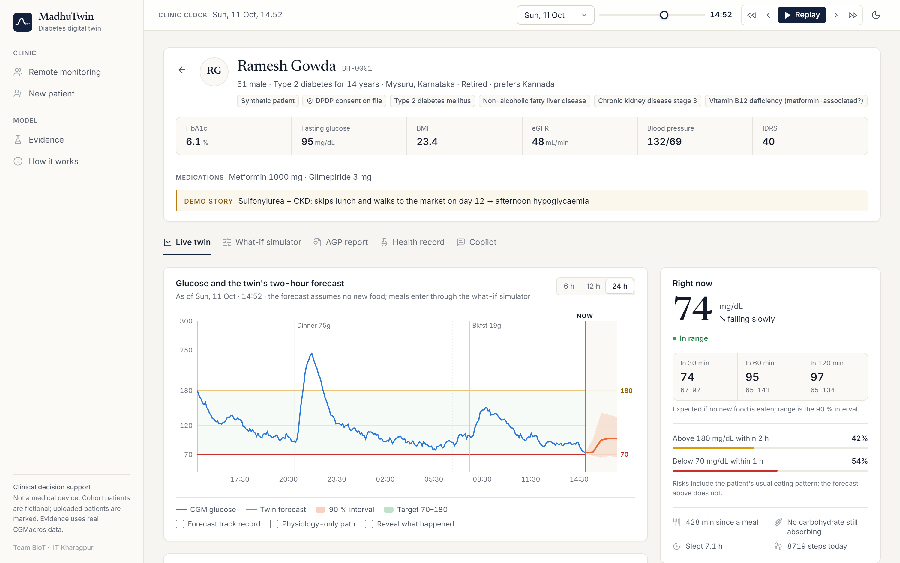
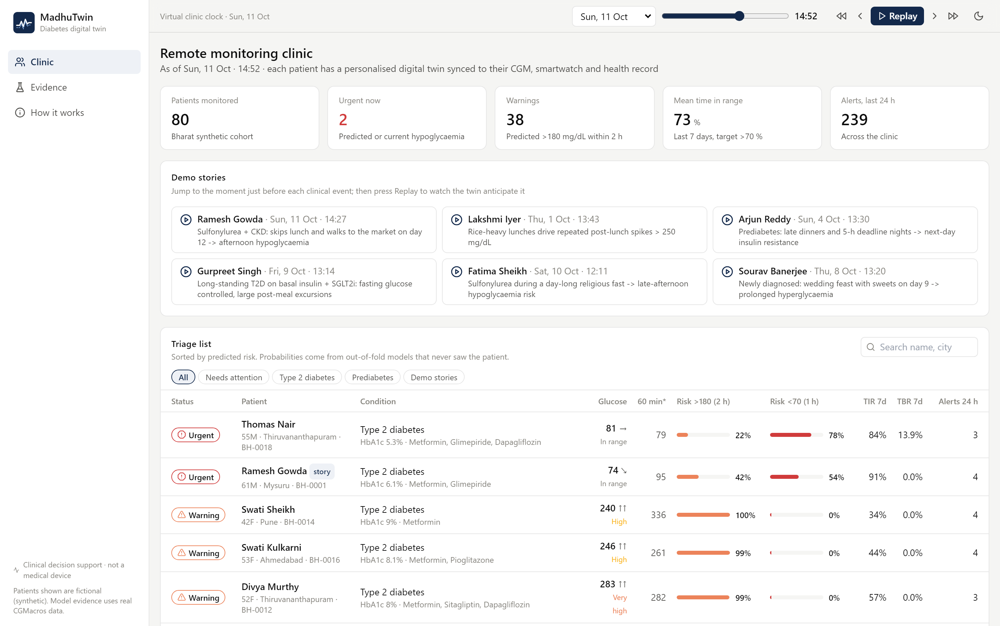
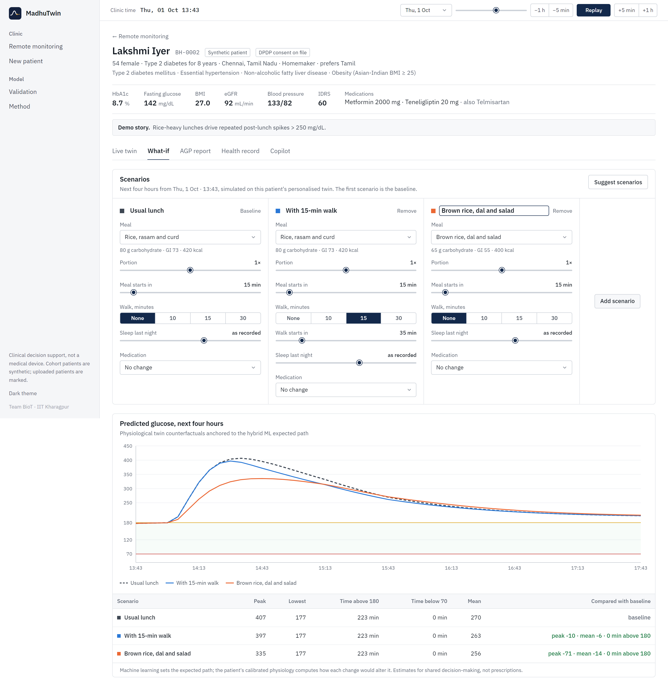
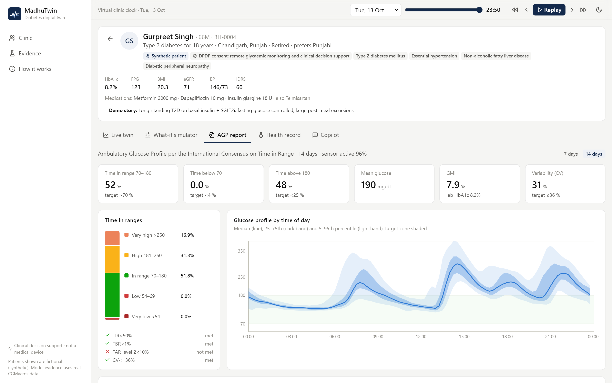
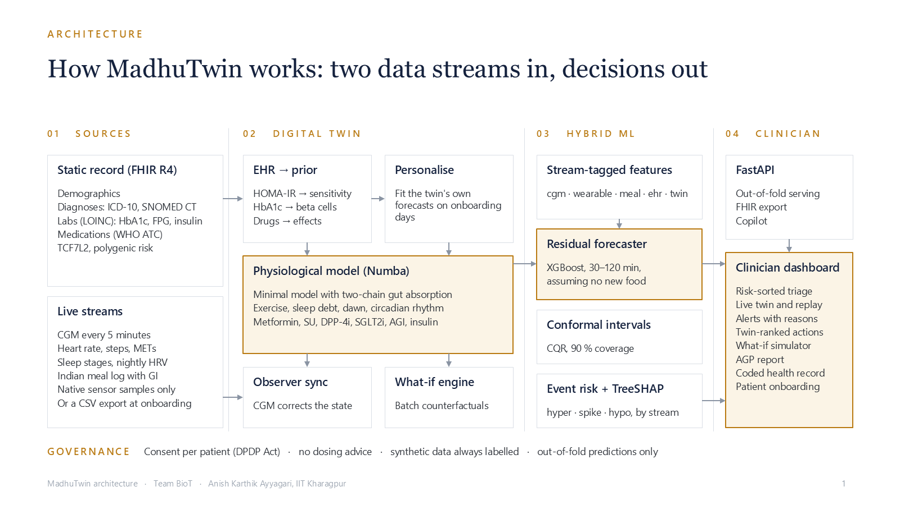
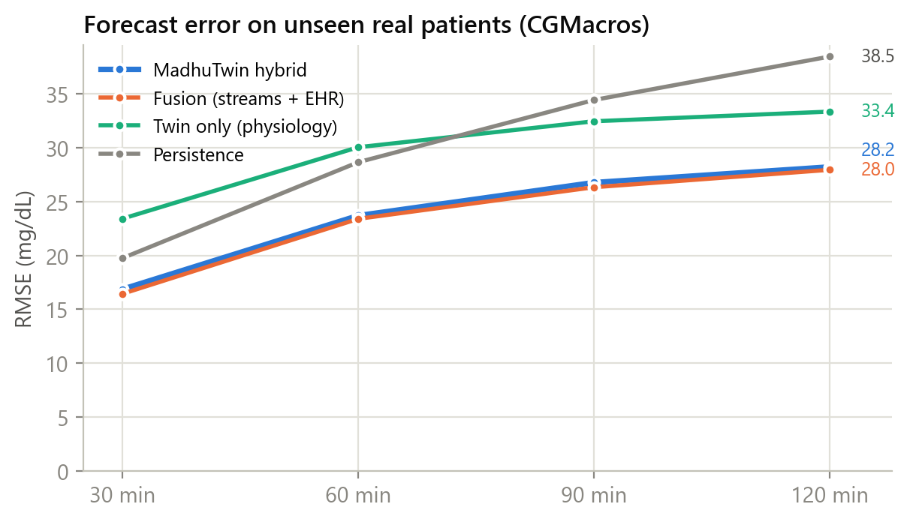
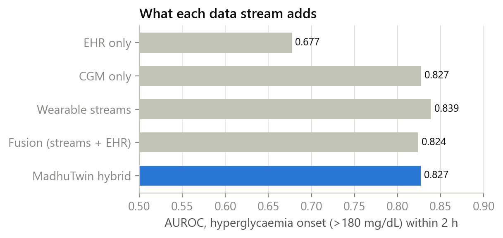
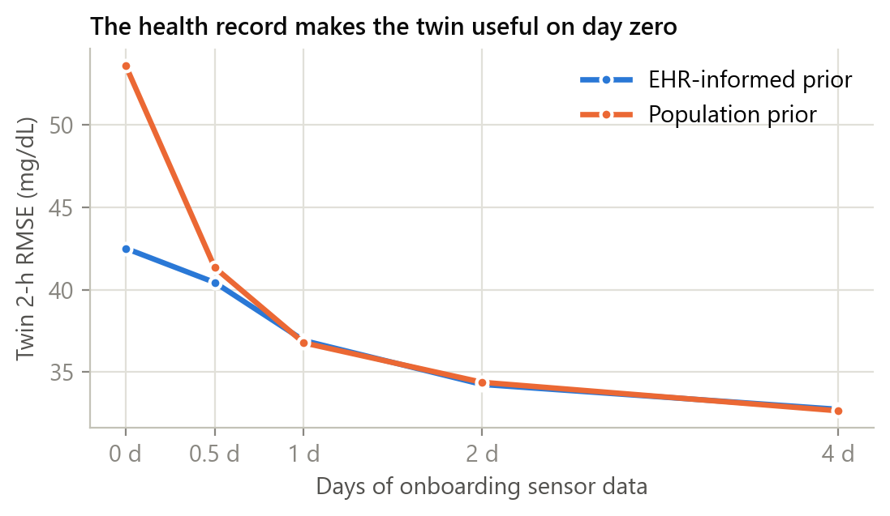
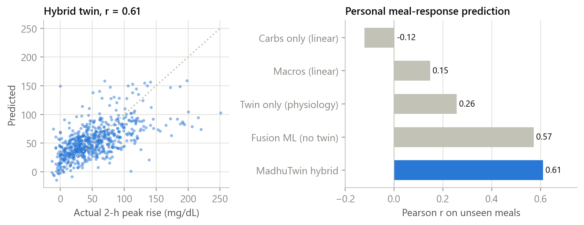
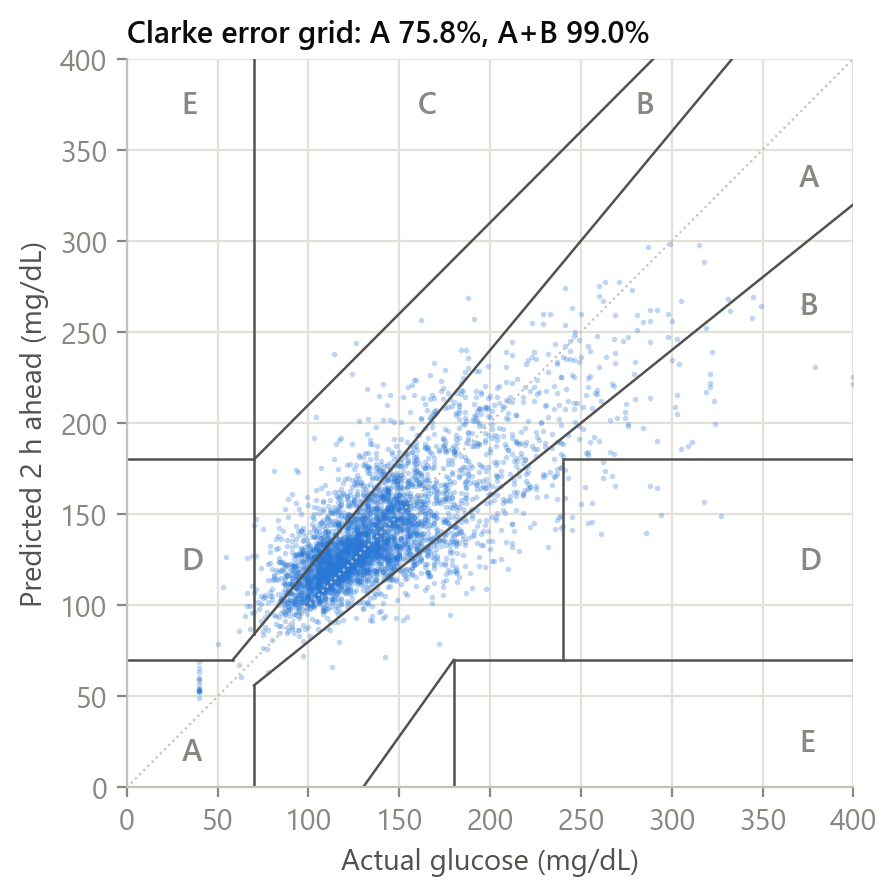

# MadhuTwin

**A hybrid physiological–AI digital twin that predicts glycaemic adverse events in type 2 diabetes, built for India.**

MadhuTwin fuses a patient's **static health record** (demographics, diagnoses, labs, medications, genetic risk) with **live wearable streams** (CGM, heart rate, steps, sleep, meal logs) into a personalised virtual patient. The twin:
- forecasts glucose up to **2 hours ahead** with calibrated uncertainty;
- predicts **hyperglycaemia, large spikes and hypoglycaemia** before they happen, and explains why;
- lets a doctor **test a meal swap, a walk or a medication change** on the patient's own physiology before the patient tries it.

*Madhu* comes from *madhumeha*, the classical Indian name for diabetes.

**Team BioT** · Anish Karthik Ayyagari · IIT Kharagpur · Digital Twin Challenge 2026



| | |
|---|---|
| Demo video (unlisted YouTube) | **[Watch the 20-minute demo](https://youtu.be/REPLACE_WITH_VIDEO_ID)** |
| Presentation | [PDF](docs/Presentation.pdf) · [PPTX](docs/Presentation.pptx) |
| Architecture diagram | [PDF](docs/Architecture.pdf) · [PPTX](docs/Architecture.pptx) |
| Full validation results | [docs/VALIDATION_REPORT.md](docs/VALIDATION_REPORT.md) |
| Run it | [Quick start](#13-quick-start) (five commands, or Docker) |

---

## Submission checklist

| Required item | Where |
|---|---|
| Team details | [§1](#1-team-details) |
| College / incubator information | [§2](#2-college--incubator) |
| Project title | [§3](#3-project-title) |
| Problem statement | [§4](#4-problem-statement) |
| Healthcare use case | [§5](#5-healthcare-use-case) |
| Technical stack | [§8](#8-technical-stack) |
| AI/ML model and framework details | [§9](#9-aiml-model-and-framework-details) and [§10](#10-results) |
| Demo video (unlisted YouTube) | [§11](#11-demo-video) |
| Open-source licence | [§18](#18-licence) |
| Architecture diagram (PDF/PPT) | [§7](#7-architecture) · [docs/Architecture.pdf](docs/Architecture.pdf) |
| Presentation (PDF/PPT) | [§12](#12-presentation) · [docs/Presentation.pdf](docs/Presentation.pdf) |
| All files and links public | Code, documents and figures are in this public repository; data is downloaded from open sources by script |

---

## 1. Team details

**Team name:** BioT

Solo entry: one team member, who is also the team leader.

| Member | Role | Institution |
|---|---|---|
| **Anish Karthik Ayyagari** (team leader) | Designed and built every component: physiological twin and personalisation, hybrid ML and real-data validation, synthetic Indian cohort, API and copilot, clinician dashboard, documentation | IIT Kharagpur |

## 2. College / incubator

- **College:** Indian Institute of Technology (IIT) Kharagpur, West Bengal, India

## 3. Project title

**MadhuTwin: a hybrid physiological–AI digital twin for predicting glycaemic adverse events in type 2 diabetes in India**

## 4. Problem statement

India has about **101 million adults with diabetes and 136 million with prediabetes** (ICMR-INDIAB 2023: 11.4 % and 15.3 % prevalence), and most do not reach glycaemic targets. Care is **reactive**. A quarterly HbA1c compresses three months into one number, so the clinic misses the two adverse events that matter most day to day:

1. **Post-meal hyperglycaemic spikes.** High-glycaemic-load meals (rice, refined wheat, sweets, tea with sugar) push glucose above 180–250 mg/dL for hours. The response to the same meal differs from person to person.
2. **Drug-induced hypoglycaemia.** Sulfonylureas are widely prescribed in India because they are inexpensive. Combined with skipped or late meals, unplanned exertion, older age or CKD, they cause dangerous lows.

CGMs and smartwatches are becoming affordable, but clinicians receive raw data dumps, not decisions. **The challenge:** build a model of *this* patient, fed by *their* record and *their* sensors, that predicts adverse events early enough to act, explains itself, and lets the doctor test interventions safely.

## 5. Healthcare use case

**Setting:** a remote glycaemic-monitoring clinic (endocrinologist, physician or diabetes educator) following patients who wear a CGM and a smartwatch and log meals on their phone.

| Step | What happens |
|---|---|
| Onboarding | The twin is created from the patient's record (HbA1c, fasting glucose and insulin, weight, medications). It is usable on day zero and personalised over the first days of sensor data. |
| Daily triage | The clinic dashboard sorts every patient by predicted risk: *urgent* (hypoglycaemia predicted or present), *warning* (above 180 mg/dL expected within 2 h), *watch*, *stable*. |
| Early warning | An alert shows the predicted time and level, the main reasons in plain language, and the share of evidence from each data stream. |
| Act | The twin ranks the next actions by simulated effect: a 15-minute walk now, a lower-glycaemic swap at the next meal, 15 g fast carbohydrate for an impending low. The clinician nudges the patient or reviews the medication. |
| Review visit | A standard AGP report, the twin's physiology (insulin sensitivity, beta-cell response, dawn effect) and a what-if simulator support counselling and treatment decisions. |
| Interoperability | Each record exports as a FHIR R4 bundle (LOINC, SNOMED CT, ICD-10, WHO ATC), compatible with ABDM-style exchange. |

**Demo stories** (fictional patients in the dashboard):

| Patient | Story |
|---|---|
| Ramesh Gowda, 61, Mysuru | Glimepiride and CKD; skips lunch and walks to the market, leading to an afternoon low the twin flags in advance |
| Lakshmi Iyer, 54, Chennai | Rice-heavy lunches drive spikes above 250 mg/dL; what-if compares millet or brown rice and a post-lunch walk |
| Arjun Reddy, 36, Bengaluru | IT professional with prediabetes; late dinners and 5-hour nights raise next-day insulin resistance |
| Gurpreet Singh, 66, Chandigarh | Long-standing T2D on basal insulin and an SGLT2 inhibitor; fasting glucose controlled, large post-meal excursions |
| Fatima Sheikh, 49, Hyderabad | Gliclazide during a day-long fast; late-afternoon hypoglycaemia |
| Sourav Banerjee, 45, Kolkata | Newly diagnosed; a wedding feast with sweets causes prolonged hyperglycaemia |

## 6. Solution overview

| Capability | How |
|---|---|
| Physiological twin | Extended Bergman minimal model with two-chain gut absorption (glycaemic index, fat, fibre, protein), endogenous insulin secretion, exercise from METs, sleep debt, dawn and circadian effects, counter-regulation, and pharmacodynamics of the drugs used in India (metformin, sulfonylureas, DPP-4 inhibitors incl. teneligliptin, SGLT2 inhibitors, voglibose, pioglitazone, basal insulin). |
| Personalisation | The EHR gives a Bayesian prior (HOMA-IR → insulin sensitivity, HbA1c and HOMA-B → beta-cell function, weight, regimen); the first days of streams refine it (maximum a posteriori fit of the twin's own 2-h forecasts). |
| State sync | Every CGM sample corrects the virtual patient; unobserved insulin, gut glucose and exercise effects evolve through physiology. |
| Hybrid ML | Gradient-boosted residual forecaster (30–120 min) over all streams plus the twin's forecast; conformal 90 % intervals; calibrated event risks; exact TreeSHAP explanations by stream. |
| What-if | Batch counterfactual simulation of meals, portions, walks, sleep and medication changes, anchored to the ML forecast. |
| New-patient onboarding | A clinician enters a short health record and uploads a CGM/wearable CSV. The record sets the prior, the first part of the recording personalises the twin, and the rest is forecast and scored by models that have never seen the patient. |
| Clinician dashboard | Triage, live twin with replay, alerts with reasons, ranked actions, what-if simulator, AGP report, coded record with FHIR export, copilot, new-patient onboarding, evidence page. |

**Key results on real patients** (CGMacros, 45 adults, leave-patients-out; details in [§10](#10-results)):

| | MadhuTwin | Baseline |
|---|---|---|
| 2-hour glucose forecast error (RMSE) | **28.2 mg/dL** | 38.5 persistence (27 % lower) |
| After meals, 2-hour RMSE | **28.4 mg/dL** | 43.2 persistence (34 % lower) |
| Clinically acceptable 2-hour forecasts (Clarke A+B) | **99.0 %** | 97.6 % persistence |
| Hyperglycaemia early warning (AUROC) | **0.83**, median lead **75 min** | 0.68 from the health record alone |
| 90 % prediction-interval coverage | **90–92 %** at every horizon | nominal 90 % |
| Personal meal-response prediction (Pearson r) | **0.61** | −0.12 carbohydrate count alone |
| Day-zero twin error with the EHR prior (2 h) | **42.5 mg/dL** | 53.6 population prior (21 % lower) |

### Dashboard

| Clinic triage | What-if simulator | Ambulatory glucose profile |
|---|---|---|
|  |  |  |

## 7. Architecture



Diagrams: [docs/Architecture.pdf](docs/Architecture.pdf) (system architecture, validation and deployment pipeline) · [PPTX](docs/Architecture.pptx).

## 8. Technical stack

| Layer | Technology |
|---|---|
| Physiology and simulation | Python 3.12, NumPy, **Numba** (JIT-compiled integrators, parallel batch simulation), SciPy (L-BFGS-B personalisation) |
| Machine learning | **XGBoost 3** (residual forecasters, quantile regression, event classifiers, TreeSHAP), scikit-learn (cross-validation, metrics) |
| Data | pandas, PyArrow (Parquet), joblib; FHIR R4 export (LOINC, SNOMED CT, ICD-10, WHO ATC, HL7 CGM IG codes) |
| API | **FastAPI**, Uvicorn, Pydantic |
| Dashboard | **React 18**, TypeScript, Vite, Tailwind CSS, Recharts, React Router; self-hosted Inter, Newsreader and IBM Plex Mono. Text meets WCAG AA contrast, alert colours follow medical-alarm priority (IEC 60601-1-8) and chart colours are checked for colour-vision deficiency |
| Copilot | Deterministic rule engine (offline); optional hosted language-model engine through the Anthropic SDK, with automatic fallback |
| Quality | pytest (physiology sanity, look-ahead test, metrics, API end-to-end), Docker |

## 9. AI/ML model and framework details

### 9.1 Physiological core (`madhutwin/physiology/model.py`)

```
dG/dt = −(S_G + X + a_ex·E)·G + EGP(t) + Ra(t) − U_renal(G)          glucose (mg/dL)
dX/dt = −p2·X + p2·S_I(t)·I                                          insulin action
dI/dt = −n·I + β·(G − h)⁺ + secretagogue + exogenous insulin           plasma insulin above basal
gut   : two parallel two-compartment chains (fast / slow carbohydrate) → Ra(t)
dE/dt = (u_ex(t) − E)/τ_ex,  u_ex = METs − 1.5                       exercise effect

EGP(t) = S_G·G_b·(1 − metformin − …) + dawn bump + counter-regulation below 72 mg/dL
S_I(t) = S_I · sleep-debt multiplier · circadian term · pioglitazone effect
```

Drug effects: metformin lowers hepatic output; sulfonylureas add glucose-independent secretion; DPP-4 inhibitors raise secretion; SGLT2 inhibitors lower the renal threshold; alpha-glucosidase inhibitors slow absorption; pioglitazone raises insulin sensitivity; basal insulin raises plasma insulin. Integrators are Numba-compiled, running thousands of four-hour simulations per second on a laptop CPU.

### 9.2 Personalisation (`madhutwin/physiology/calibrate.py`)

- **Prior from routine labs:** fasting glucose → basal glucose; HOMA-IR = FPG × insulin / 405 → insulin sensitivity; HbA1c and HOMA-B → beta-cell responsiveness; HbA1c → glucose effectiveness and dawn effect; weight → distribution volume. Log-normal priors.
- **Likelihood from streams:** on an onboarding window (first 40 % of the record, at most 4 days), the twin is synced to the CGM and forecasts 30/60/90/120 min ahead from hundreds of start points. Squared forecast error is the likelihood (prediction-error method, robust to drift).
- **MAP estimate** of 9 parameters (basal glucose, glucose effectiveness, insulin sensitivity, beta-cell response, absorption speed, bioavailability, exercise response, dawn amplitude, circadian amplitude) by L-BFGS-B in log space.

### 9.3 Hybrid ML layer (`madhutwin/ml/models.py`, `madhutwin/features.py`)

- **Features (78), causal and tagged by stream:** CGM (level, deltas, acceleration, rolling statistics, 24-h baseline); wearable (heart rate vs resting, METs, active minutes, steps, sleep duration, deep-sleep fraction, HRV); meals (carbs, fat, fibre, protein, kcal in recent windows, time since meal); EHR (age, sex, BMI, HbA1c, FPG, insulin, HOMA, lipids, eGFR, genetics, medications); twin (forecast deltas, peak and trough, gut carbohydrate, glucose appearance rate, insulin action, exercise state, personalised parameters); time of day.
- **Forecasts:** one XGBoost regressor per horizon predicts the change from now. Deployed forecasts are **conditional on no new food** (trained on windows without a logged meal inside the horizon), matching the twin, which adds new meals mechanistically.
- **Uncertainty:** conformalised quantile regression (Romano et al., 2019) on held-out calibration patients gives 90 % intervals with a finite-sample coverage guarantee.
- **Events:** XGBoost classifiers for hyperglycaemia onset (>180 mg/dL within 2 h), spike (≥ +50 mg/dL within 2 h) and hypoglycaemia onset (<70 mg/dL within 1 h). Alert thresholds are asymmetric (hypo 25 %, hyper 50 %).
- **Explanations:** exact TreeSHAP contributions, rendered as plain-language drivers and aggregated into per-stream shares.
- **What-if:** scenario curve = twin simulation under the scenario + the ML residual of the no-change forecast. ML sets the expected path; physiology supplies the causal difference.
- **Out-of-fold serving:** every prediction shown for a patient comes from the cross-validation model that never saw that patient.

### 9.4 Validation protocol

- **Real data:** CGMacros (PhysioNet), 45 adults (15 normoglycaemic, 16 prediabetes, 14 T2D) with Dexcom/Libre CGM, Fitbit, meals and labs.
- **5-fold leave-patients-out** cross-validation, stratified by glycaemic group. Each test patient's twin is personalised only on their own onboarding days; all metrics come from the later, unseen monitoring period (80,676 forecasts, 311 patient-days).
- **Leakage control:** the public files interpolate CGM to 1 minute, so an interpolated value encodes the next reading. We recover the native sensor grid and use true samples only. A unit test verifies that features at minute *t* are identical whether or not later data exists.
- **Fair ablation:** every model sees identical rows; only inputs differ (EHR only → CGM only → CGM + EHR → wearable streams → fusion → fusion + twin).

## 10. Results

All numbers below are regenerated by the scripts in [§14](#14-reproducing-the-results). The complete tables are in [docs/VALIDATION_REPORT.md](docs/VALIDATION_REPORT.md).

**Forecast accuracy on unseen real patients** (RMSE, mg/dL)

| Model | 30 min | 60 min | 90 min | 120 min | Clarke A+B, 2 h |
|---|---:|---:|---:|---:|---:|
| Persistence | 19.8 | 28.7 | 34.4 | 38.5 | 97.6 % |
| Physiology only (personalised twin) | 23.4 | 30.1 | 32.5 | 33.4 | 98.2 % |
| CGM only (ML) | 17.1 | 24.2 | 27.4 | 29.1 | 98.7 % |
| Fusion: streams + EHR (ML) | 16.4 | 23.4 | 26.3 | 28.0 | 98.9 % |
| **MadhuTwin hybrid** | **16.9** | **23.7** | **26.8** | **28.2** | **99.0 %** |

On meal-free windows, the deployed conditional forecaster reaches **24.4 mg/dL at 2 h** vs 34.8 for persistence (30 % lower), the best of all models compared.

<p align="center"> </p>

**Early warning of hyperglycaemia** (onset >180 mg/dL within 2 h): AUROC 0.83; **61 % of episodes flagged at least 15 minutes ahead (70 % for the CGM-only model); median lead time 75 minutes**; about 1.4 false alerts per patient-day at a 0.5 threshold. The health record alone identifies *who* is at risk (AUROC 0.68); live streams identify *when*. Spike (+50 mg/dL) AUROC 0.82; hypoglycaemia AUROC 0.85 (rare in this cohort: 0.35 % of moments).

**Calibrated uncertainty:** observed coverage of the 90 % interval is 90.3 / 91.2 / 92.1 / 91.7 % at 30 / 60 / 90 / 120 min.

**Where the twin earns its place**

<p align="center"> </p>

- **Day-zero personalisation:** before any sensor data, the EHR-informed twin's 2-hour error is 42.5 vs 53.6 mg/dL with a population prior (21 % lower). After about a day of CGM the streams dominate.
- **Personal meal response:** predicted vs actual 2-hour peak rise on 664 unseen meals, r = 0.61 (fusion without the twin 0.57; carbohydrate count alone −0.12).
- **Personalisation works:** the physiology-only 2-hour error falls from 41.9 (EHR prior) to 29.7 mg/dL after onboarding; twin-estimated insulin sensitivity tracks lab HOMA-IR (Spearman ρ = −0.68).

**Bharat synthetic cohort** (80 fictional Indian patients, held out by fold, labelled SYNTHETIC; it tests Indian diets, drugs, sleep and step streams, not real-world accuracy):

| | MadhuTwin | Comparison |
|---|---|---|
| 2-hour RMSE, meal-free windows (conditional forecaster) | 14.1 mg/dL | 39.7 persistence; 14.3 fusion without the twin |
| Hypoglycaemia onset within 1 h (AUROC) | 0.99 | prevalence 0.8 % of moments |
| Hypoglycaemia episodes flagged ≥10 min ahead (alert ≥25 %) | 57 % (77 of 135), median lead 55 min | 0.14 false alerts per patient-day |
| Hyperglycaemia episodes flagged ≥15 min ahead | 94 %, median lead 95 min | AUROC 0.93 |

**What did not work (kept on record):**
- Adding twin features to the ML layer did not beat the best fusion model on rolling real-data forecasts.
- Three ideas were tested on held-out data and switched off because they did not improve accuracy: a disturbance observer, an activity-persistence prior and a fasting steady-state constraint.
- Static EHR features add little to short-term forecasts once CGM is available.
- Before rare lows, point forecasts regress towards typical levels; the calibrated hypoglycaemia classifier is the primary signal, which is why the dashboard shows risk alongside the forecast line.

<p align="center"></p>

## 11. Demo video

**[Watch the demo on YouTube (unlisted, ~20 minutes)](https://youtu.be/REPLACE_WITH_VIDEO_ID)**

The video covers the problem, how the twin works, a live walkthrough of the dashboard (the hypoglycaemia and rice-spike stories, the what-if simulator, the AGP report, FHIR export, copilot) and the real-data evidence.

## 12. Presentation

[docs/Presentation.pdf](docs/Presentation.pdf) · [docs/Presentation.pptx](docs/Presentation.pptx): problem, solution, how the twin works, demo, evidence, limitations, India readiness and roadmap.

## 13. Quick start

Requires Python 3.12 and Node.js 18 or later.

```bash
pip install -r requirements.txt
cd dashboard && npm ci && npm run build && cd ..
python scripts/build_bharat.py          # synthetic Indian cohort + twins + features (~2 min)
python scripts/train_deploy.py --quick  # demo models (~10 min); omit --quick for the full models
uvicorn madhutwin.api.main:app --port 8000
# open http://localhost:8000   (API docs at /docs)
```

The Evidence page shows the committed real-data results, so no download is needed to run the demo.

**Docker (alternative):** `docker compose up --build`, then open http://localhost:8000. The image runs the same steps: it builds the dashboard, generates the cohort and trains the demo models (about 10 minutes the first time).

For dashboard development, run `npm run dev` in `dashboard/` (port 5173, proxies `/api` to port 8000).

**Using the dashboard:** pick a *Demo story* on the Clinic page, press **Replay** to advance the virtual clock, and watch the alert appear before the event. Tick *Reveal what happened* to compare the forecast with reality. The copilot runs offline; set `ANTHROPIC_API_KEY` to enable the optional hosted language-model engine.

**Adding your own patient:** open **New patient**, fill in the health record (age, weight and HbA1c are required; other labs sharpen the prior), add the diabetes medicines and drop in a CSV of at least 24 hours of CGM readings. **Load sample patient** fills the page with a fictional patient that none of the models has seen ([data/samples/](data/samples/)). Building the twin takes a few seconds. The result shows what the recording taught the twin; on the sample, its own 2-hour error falls from 74 to 40 mg/dL. **Open twin** starts the replay just before the first alert raised after onboarding. Uploaded patients are saved under `data/uploaded/` (not versioned) and can be removed from their patient page.

| CSV column | | Meaning |
|---|---|---|
| `timestamp` | required | date and time of the reading, e.g. `2026-10-05 07:35` |
| `glucose_mgdl` | required | CGM glucose in mg/dL (mmol/L is detected and converted) |
| `heart_rate` | optional | beats per minute |
| `steps` | optional | steps from this row's time until the next row |
| `carbs_g` | optional | grams of carbohydrate, on the row where a meal starts |
| `protein_g`, `fat_g`, `fiber_g`, `meal` | optional | meal detail and name (names are matched to the Indian food library) |

Column names are case-insensitive, and the names used by common CGM exports (for example `Device Timestamp` and `Historic Glucose mg/dL`) are recognised. The recording is moved by whole days onto the clinic's 14-day timeline, so times of day are kept. The same flow is available as `POST /api/onboard`.

## 14. Reproducing the results

```bash
python scripts/download_cgmacros.py      # CGMacros from PhysioNet (open access, ~630 MB), checksum-verified
python scripts/build_cgmacros.py         # causal loader, per-patient twins, features (~20 s)
python scripts/evaluate_cgmacros.py      # leave-patients-out validation study (~15 min)
python scripts/analysis_twin_value.py    # cold-start and data-efficiency analyses
python scripts/build_bharat.py           # synthetic cohort
python scripts/train_deploy.py           # fold models + synthetic metrics (~30 min)
python scripts/make_figures.py           # figures in reports/figures
python scripts/write_validation_report.py
python -m pytest
```

Runtimes are for a 12-core laptop CPU; no GPU is needed. Seeds are fixed.

## 15. Repository structure

```
madhutwin/
  physiology/   model.py (twin ODEs, Numba), calibrate.py (EHR prior + MAP personalisation)
  data/         cgmacros.py (causal loader), synth_cohort.py (Bharat cohort), indian_foods.py, fhir.py
  ml/           models.py (hybrid forecaster, CQR, classifiers, SHAP), metrics.py (Clarke grid, episodes)
  api/          main.py (FastAPI), service.py (triage, timeline, alerts, what-if, recommendations)
  twin.py       DigitalTwin: create, personalise, sync, forecast, what-if, phenotype
  onboarding.py new patient from a health record + CGM/wearable CSV (parse, personalise, score)
  features.py   causal, stream-tagged features      agp.py  consensus CGM metrics and AGP
  copilot.py    grounded clinical summary           explain_text.py  plain-language explanations
dashboard/      React + TypeScript clinician dashboard
scripts/        download, build, evaluate, train, figures, report, sample upload
data/samples/   fictional sample upload for the New patient page
reports/        metrics (*.json) and figures
docs/           presentation, architecture, data, privacy and safety, validation report, screenshots
tests/          physiology, causality (look-ahead), metrics, API
```

## 16. Data, privacy and safety

- **Data:** real CGMacros data for evidence and the synthetic Bharat cohort for the demo, never mixed in reported results. Sources, licences, preprocessing and generation are in [docs/DATA.md](docs/DATA.md).
- **Privacy and safety:** DPDP Act 2023 design notes, clinical-safety guardrails and the regulatory pathway are in [docs/PRIVACY_AND_SAFETY.md](docs/PRIVACY_AND_SAFETY.md).
- MadhuTwin is a research prototype for clinical decision support. It is **not a medical device** and gives no dosing instructions.

## 17. Limitations and roadmap

- The real cohort is small (45 US adults, about 10 days each). Indian demographics, diets and drugs are exercised on a synthetic cohort.
- Point forecasts regress towards typical levels before rare lows; hypoglycaemia alerts rely on the calibrated classifier.
- Meal logs are self-estimated; carbohydrate-counting error limits meal-response accuracy, as in real life.
- **Next:**
  1. a prospective pilot with an Indian remote-monitoring clinic (alert-guided vs usual care on time in range and hypoglycaemia);
  2. photo-based Indian meal logging;
  3. support for lower-cost sensors and an on-device twin for low-connectivity settings;
  4. extending the same twin framework to hypertension and cardiovascular risk.

## 18. Licence

- **Code:** [Apache License 2.0](LICENSE). See also [NOTICE](NOTICE).
- **CGMacros data** (not redistributed) is CC BY-NC-SA 4.0. Models and metrics derived from it are shared for non-commercial research use under the same terms.
- **Bharat synthetic cohort** (generated by this code): CC BY 4.0.

## 19. References

- Anjana R.M. et al. Metabolic non-communicable disease health report of India: the ICMR-INDIAB national cross-sectional study (ICMR-INDIAB-17). *Lancet Diabetes Endocrinol* 2023.
- Gutierrez-Osuna R., Kerr D., Mortazavi B., Das A. CGMacros: a scientific dataset for personalized nutrition and diet monitoring (v1.0.0). PhysioNet 2025. doi:10.13026/3z8q-x658
- Bergman R.N. et al. Quantitative estimation of insulin sensitivity. *Am J Physiol* 1979.
- Dalla Man C., Rizza R.A., Cobelli C. Meal simulation model of the glucose-insulin system. *IEEE Trans Biomed Eng* 2007.
- Battelino T. et al. Clinical targets for continuous glucose monitoring data interpretation: recommendations from the International Consensus on Time in Range. *Diabetes Care* 2019.
- Bergenstal R.M. et al. Glucose Management Indicator (GMI). *Diabetes Care* 2018.
- Clarke W.L. et al. Evaluating clinical accuracy of systems for self-monitoring of blood glucose. *Diabetes Care* 1987.
- Romano Y., Patterson E., Candès E. Conformalized quantile regression. *NeurIPS* 2019.
- Lundberg S.M. et al. From local explanations to global understanding with explainable AI for trees. *Nat Mach Intell* 2020.
- Zeevi D. et al. Personalized nutrition by prediction of glycemic responses. *Cell* 2015.
- Mohan V. et al. A simplified Indian Diabetes Risk Score for screening for undiagnosed diabetic subjects. *JAPI* 2005.
- Donga E. et al. A single night of partial sleep deprivation induces insulin resistance in multiple metabolic pathways. *JCEM* 2010.
- Longvah T. et al. Indian Food Composition Tables 2017. ICMR-National Institute of Nutrition.
